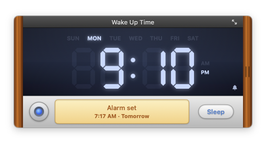

# Wake Up Time



A Swift/SwiftUI reimplementation of the macOS alarm clock app **Wake Up Time** (Rocky Sand Studio, v1.4).
The feature set and UI are rebuilt from the original app's bundle resources, help book, and binary strings.

## Download

Get `WakeUpTime.zip` from [Releases](https://github.com/moonlightpark/Wake-Up-Time/releases), unzip it, and move it to Applications.
The app is ad-hoc signed and not notarized, so the first launch is blocked by Gatekeeper.
Right-click it in Finder → **Open**, or run:

```bash
xattr -dr com.apple.quarantine "/Applications/Wake Up Time.app"
```

## Build & run

```bash
./build_app.sh            # → build/Wake Up Time.app
open "build/Wake Up Time.app"
# or during development
swift run
```

Requirements: macOS 14+, Xcode (Swift 5.10+)

## Features (same as the original)

| Original feature | Implementation |
|---|---|
| Main window: wood panels, LCD (7-segment + ghosted 88:88, SUN–SAT, AM/PM), flashing colon | `MainView.swift`, `SevenSegment.swift` |
| Main Switch (LED) / HUD / Sleep button | `MainView.swift` |
| Right drawer (⌘D, double-click the right wood): alarm time, sound, volume, Fade, test playback | `DrawerView.swift` |
| Changing the alarm time turns the switch on automatically; Today/Tomorrow shown | `DrawerView.swift`, `AlarmController.swift` |
| While ringing, click anywhere or press any key → snooze; × → stop, re-arms for the next day | `AlarmController.swift`, `AppDelegate.swift` |
| Fade (volume rises over 30 s), Random sound | `SoundLibrary.swift` |
| Raises system volume during the alarm and restores it afterwards | `SystemServices.swift` (CoreAudio) |
| Preferences — General / Sounds (hide, add, remove, rename, drag & drop) / Clocks | `Preferences.swift` |
| 11 full-screen clock styles, ESC to exit | `ClockFaces.swift`, `FullScreenClock.swift` |

## Differences from the original

- **Sleep button**: the original used a separately installed privileged helper to sleep the Mac and wake it at alarm time.
  This version needs no helper. It keeps the Mac awake (`PreventUserIdleSystemSleep`) while an alarm is set,
  turns only the display off (`pmset displaysleepnow`), and turns the display back on when the alarm rings.
- **Sounds**: the original's mp3, image, and font assets are copyrighted, so none are copied. The built-in sounds
  (Digital, Pulse, Ringer, Chime, Sunrise, Cosmic) are synthesized in code, and macOS system sounds are offered too.
- Removed: in-app purchases / receipt validation, rating, newsletter, and promotional (Wake Up Light) windows.
